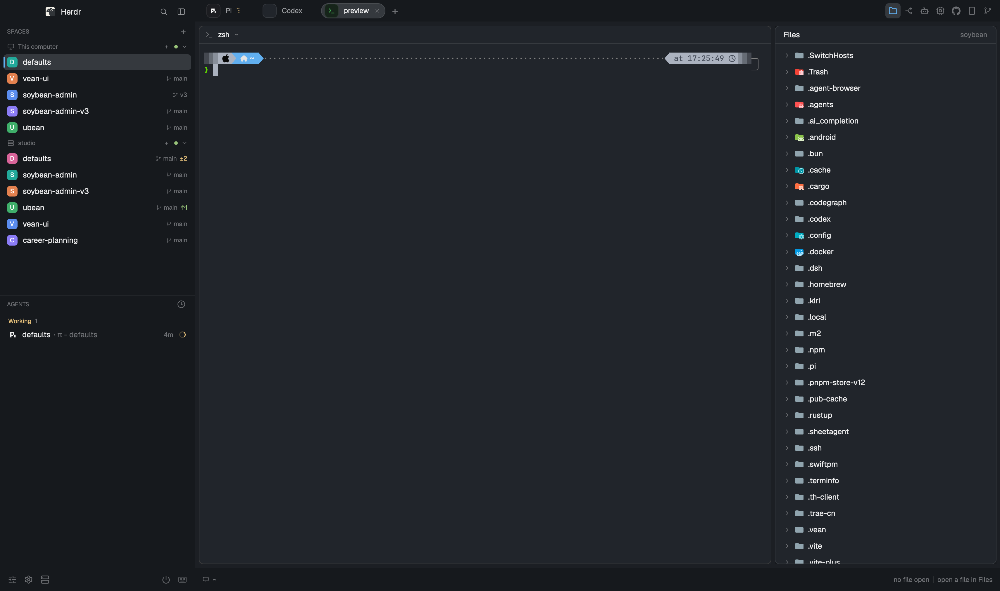

# Soybean

A dark, editor-shaped Herdr window: a fixed 256px spaces-and-agents sidebar, a Chrome-like tab strip over one bordered terminal pane, a 360px right panel that swaps between six tools, and a 40px status bar. Built for driving several coding agents at once from a single window.

## What you see

- `root`: a `row` on `background: "canvas"` (#0b0b0b), `theme: "agentee"`, `font: "JetBrains Mono"` at 13, `ui_font: "Geist"`, `terminal_padding: [8,10]`, a 1px `divider` in `border` (#2b2b2b), `titlebar: "none"`, `traffic_lights: [12,16]`, `movable: true`.
- Left `sidebar`: 256px wide (`min: 44`, `max: 420`, `resizable: false`, `background: "chrome"` #111111). A column of four blocks: `brand` 40px `workspace-chrome` (`window_drag: true`), `spaces` `agentee-spaces` (`weight: 1`, `min: 90`), `agents` `agentee-agents-list` (`weight: 1`, `min: 90`), `sidebar-footer` 40px `agentee-chrome` with `props.role: "footer"`.
- Right `work`: a column, `resizable: false`. `tabs` is a 38px `soybean-tabs` strip (`window_drag: true`). `work-body` is a `row` with `padding: 6` and `gap: 6`:
  - `main`: `content: {"tab":"active","pane":{...}}`. The pane has a 30px header on top, `reveal: "always"`, drawn by `pane-chat`; `background: "background"` (#161616), 1px `border` border, 1px `#3d3d3d` focus ring, `radius: 8`, `gap: 6`, `lone: true`.
  - `panel`: 360px (`min: 260`, `max: 760`, `background: "chrome"`), a column holding `panel-body`, a `stack` whose `active` child is `panel-files`. Its six blocks are `panel-files` (`file-icons`), `panel-routing` (`magpie-routing`), `panel-agents` (`agentee-agents`), `panel-system` (`agentee-system`), `panel-graph` (`git-graph`) and `panel-github` (`mission-control-github`).
  - `status`: 40px `agentee-status`.
- `themes/agentee.json`: `background` #161616, `foreground` #f4f4f4, `canvas` #0b0b0b, `chrome` #111111, `surface` #1c1c1c, `raised` #262626, `border` #2b2b2b, `accent` / `working` #78a9ff, `blocked` #fa4d56, `done` #42be65, `idle` #8d8d8d, `unknown` #be95ff.

## How it behaves

- Agent state in `agentee-agents-list` is grouped into `Needs you` (blocked), `Done`, `Working`, `Idle` by rank 4/3/2/1. Working draws a spinner in `t.working`; blocked draws a `Needs you` chip (or `!` when compact); idle a 7px ring; done a filled dot. Viewing a finished agent keeps it under `Done` until you leave it, then it becomes idle.
- `soybean-tabs`: a working tab spins in `t.working`, blocked and done show 6px dots, `+` opens the shipped `new-menu` popup, dragging a tab onto another calls `tab.move`. On the right of the strip are six 26px buttons (Files, Routing, Agents, System, GitHub, Git): clicking a different one runs `layout.show {id:"panel"}` then `layout.select {stack:"panel-body", child:<id>}`; clicking the one already shown runs `layout.hide {id:"panel"}`. The Git button carries a dot from `shared("agentee.git.status")` (conflicts or behind: `blocked`, changes: `ansi3`, ahead: `done`) and a tooltip with branch plus pending counts. Min/max/close buttons appear when `window().buttons` is set.
- `pane-chat` header shows the program icon, the agent name or terminal title, the folder, the status (`Working…`, `Chat`, `Terminal`) and split / zoom / close controls. Clicking it focuses the pane.
- `agentee-spaces`: click a space to `space.select`, right-click for its menu, drag to reorder. Rows show a colored avatar, the name, branch and ahead/behind plus git dots; worktrees nest under their checkout. Under 160px the sidebar mods draw a compact rail (44px, 76px on macOS for the traffic lights).
- `agentee-status` shows the focused folder's git state on the left and the file published to `shared("agentee.editor")` on the right. With no editor it reads `no file open · open a file in Files`; that link shows `panel` and selects `panel-files`. It also exposes a `⌘S` save chip for the editor pane.
- `agentee-chrome` footer opens `picker` (search), `agentee-settings` (theme settings dialog), toggles the right panel, and toggles the sidebar.
- `ctrl-shift-l` cycles layouts; `layout.switch soybean` selects this one. Mods drive `layout.show/hide/select/resize/switch`, `space.new/select`, `tab.new/select/close/rename/move`, `pane.split/close/zoom/focus`, `mod.open` and the window commands.
- The six stacked panels: Files is a lazy file tree with VS Code Material Icon Theme icons and bounded read-only previews; Routing draws magpie's live gateway stage; Agents shows live agents plus measured token analytics; System shows real CPU/disk/network samples (`sampling...` before the second reading, `unavailable` for missing probes); Git graph draws the repo's commit graph; GitHub opens Mission Control's GitHub board and dialog.

## Built from

- `layouts/soybean.json`: `row` → `column` (sidebar) + `column` (work) → `row` (work-body) → `stack` (panel-body). `themes/agentee.json` supplies every named color.
- Bundled mods, all `place: "none"`: `agentee-agents`, `agentee-agents-list`, `agentee-chrome`, `agentee-settings`, `agentee-spaces`, `agentee-status`, `agentee-system`, `file-icons`, `git-graph`, `magpie-routing`, `mission-control-github`, `pane-chat`, `soybean-tabs`. Shipped mod used: `workspace-chrome` (brand). Shipped overlays used: `new-menu`, `picker`, `machine-add`, `menu`.
- `herdr` API used: `spaces`, `panes`, `focused`, `layout`, `window`, `theme`, `shared`, `setShared`, `run`, `openOverlay`, `exec`, `home`, `appHome`, `settings`, `agents`, `terminals`.
- Commands: `layout.show/hide/select/resize/switch`, `space.new/select/move`, `tab.new/select/close/rename/move`, `pane.split/close/zoom/focus/go`, `mod.open`, `app.settings/help/palette`, `window.minimize/maximize/close`, `agentee.git.status/changed`, `agentee.settings`, `agentee-editor.save`, `terminal.pin/peek/keep/kill`.
- Programs executed: `git` (status, log, remote, rev-parse), `sh`, `find`, `tail`, `node`, `env`, `hc`, `herdr-app`, `mkdir`, `sleep`, and `powershell` on Windows.
- Art: `mods/soybean-tabs/icons/{folder,route,bot,cpu,github,branch}.svg` and `win-{min,max,restore,close}.svg`, `mods/file-icons/icons` + `icons-material` (VS Code Material Icon Theme), `mods/magpie-routing/{wire,bird}.svg`, `mods/agentee-settings/icons/*.svg`, `mods/agentee-*/icons/*.svg`, plus the shipped `mods/workspace-chrome/spinner.svg`.

## Watch out

- Name clashes: these mod names come from other people's layouts. If one is already installed, rename the folder, every `"mod"` value in `layouts/soybean.json`, and every `mods/<name>/...` path inside the mod's own JS before copying. Never overwrite.
- Fonts: `JetBrains Mono` and `Geist` are not bundled. Without them Herdr falls back and the fixed 38px/40px strips can look different.
- The `Add phone` button was removed from this copy of `soybean-tabs`: it opened `add-phone`, whose `config.js` hardcodes `/Users/soybean/.local/bin/herdr-anywhere`, and used `mods/orca-nav/smartphone.svg`. Restore it only if you also bundle `add-phone`, `orca-nav` and a portable `herdr-anywhere` path.
- `magpie-routing` reads `~/.config/magpie/routing/<date>.jsonl` with `tail -n 60`; without magpie it shows `no routing log yet`.
- `git-graph` needs git repositories and parses GitHub remotes. `mission-control-github` needs the `gh` CLI and an authenticated account. `agentee-agents/tokens.mjs` reads agent session logs under the home directory. `agentee-chrome` / `agentee-system` read `appHome()/agentee-settings.json` only as a fallback when `shared("agentee.settings")` is empty.
- `pane-chat` Autopilot opens `shepherdr-settings` and calls `mods/tasks/bin/herdr-task`; neither mod is installed on the source machine and neither is bundled here. Those controls do nothing until the mods are added.
- Only one child of `panel-body` renders at a time, but hidden children keep their timers. `panel` is 360px by default (`min 260`, `max 760`); `sidebar` has `resizable: false` even though its mods still call `layout.resize`.
- `titlebar: "none"` with `traffic_lights: [12,16]` leaves room for macOS window buttons; `agentee-chrome` pads 76px and `soybean-tabs` computes its own left padding on macOS. Windows draws min/max/close from `mods/soybean-tabs/icons/win-*.svg`.
- Licensing: `file-icons` is derived from Herdr's shipped `files` mod (Apache-2.0), and the `agentee-*` / `git-graph` / `magpie-routing` / `mission-control-github` / `pane-chat` mods come from other layouts. Check their licenses before publishing a derivative.

## Done when

- `herdr-app check <folder>` passes for all 13 bundled mods. Verified on the source machine after packaging: `agentee-agents`, `agentee-agents-list`, `agentee-chrome`, `agentee-settings`, `agentee-spaces`, `agentee-status`, `agentee-system`, `file-icons`, `git-graph`, `magpie-routing`, `mission-control-github`, `pane-chat`, `soybean-tabs`.
- `layout.switch soybean` shows the sidebar, tab strip, terminal pane, right panel and status bar as in `preview.png`, and `herdr-app status` reports `"layout": "soybean"` with no errors.
- Each right-hand strip button selects its stack child; clicking the active one hides `panel`; `ctrl-shift-l` returns to the previous layout.
- Files lists the focused pane's folder with Material icons, and Git graph renders commits for a repository in that folder.
- No `mods/<name>/...` asset path in the bundled JS points outside this repo, except the optional Autopilot CLI noted above.
